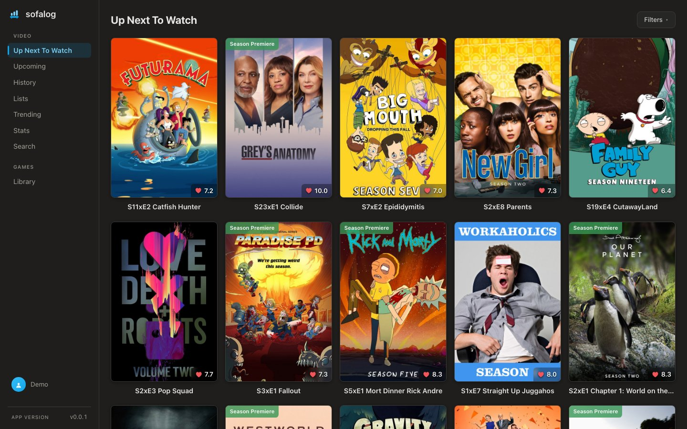
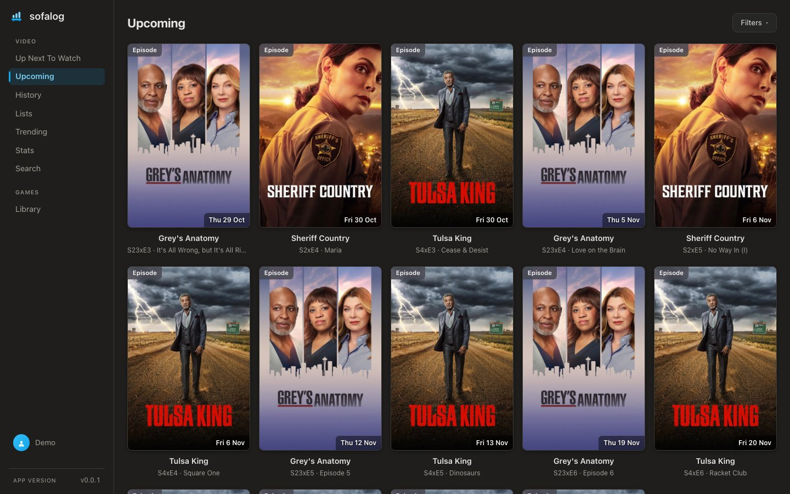
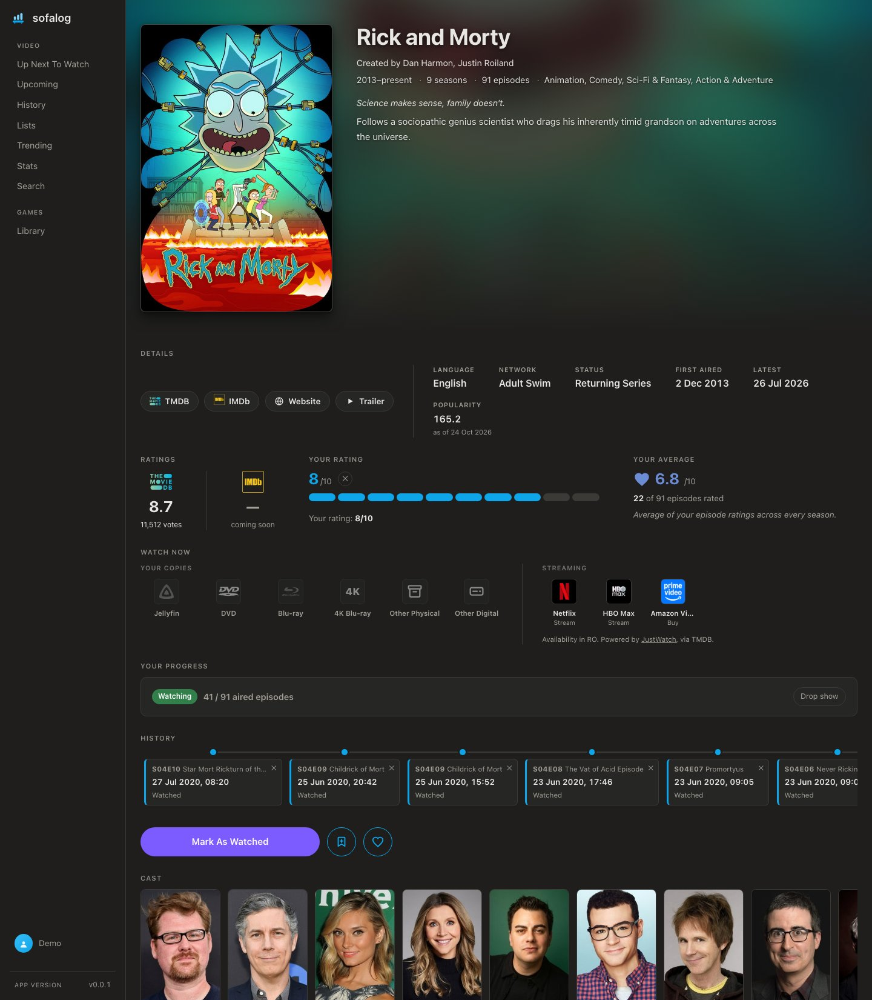
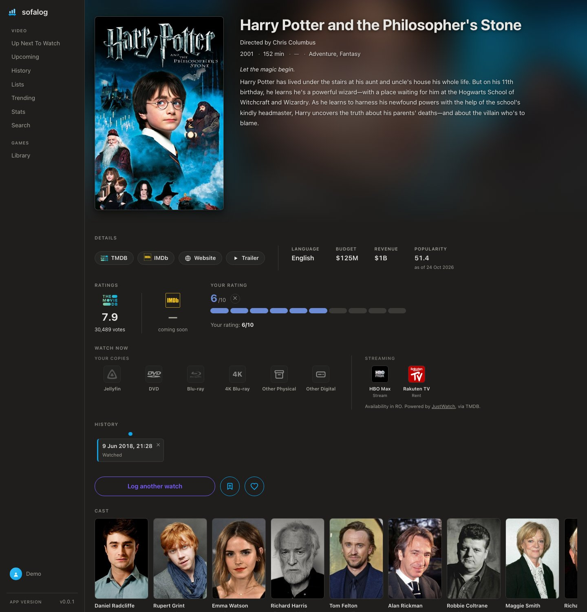
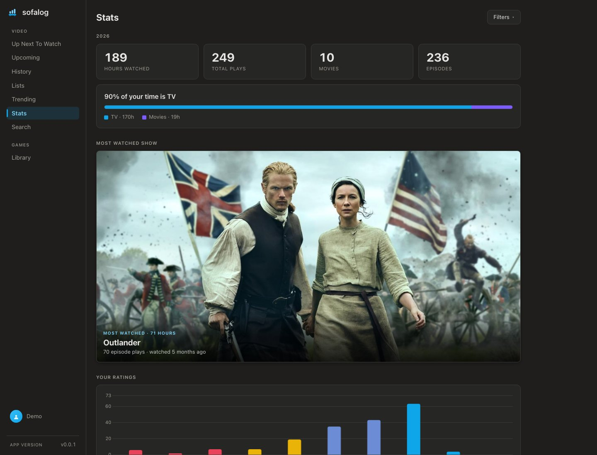
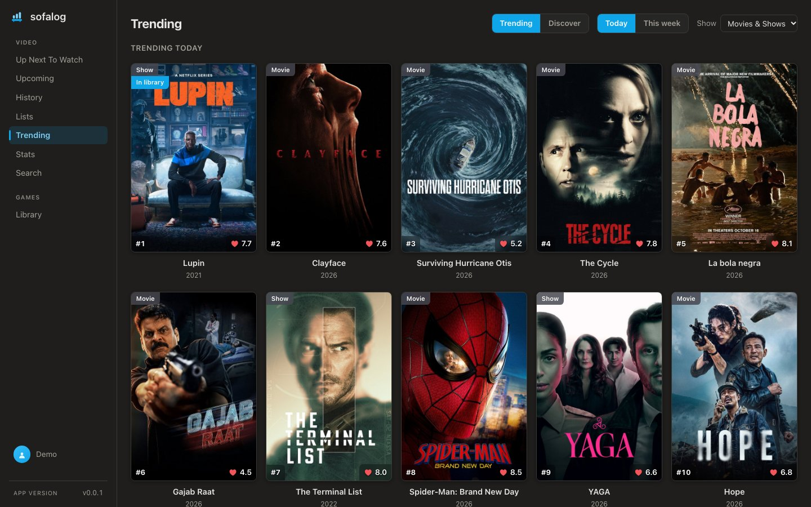
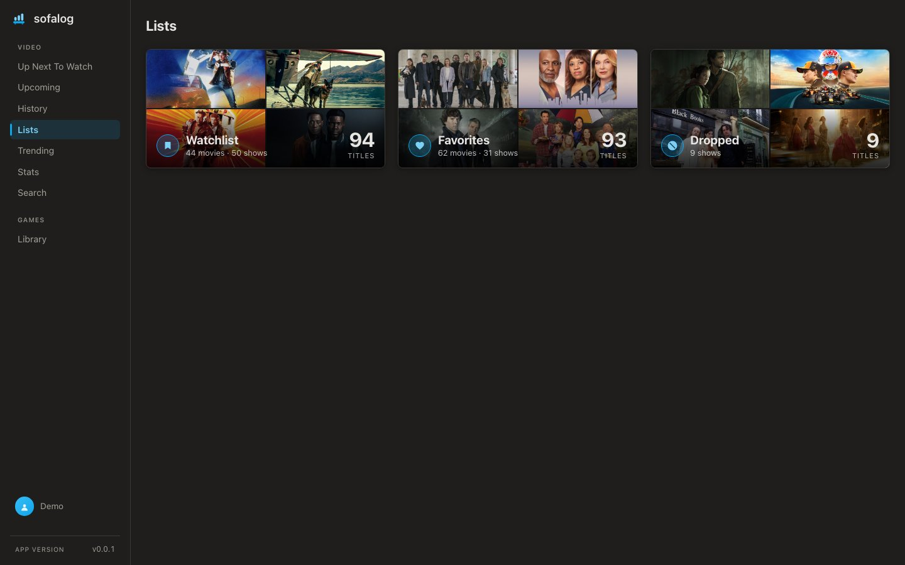
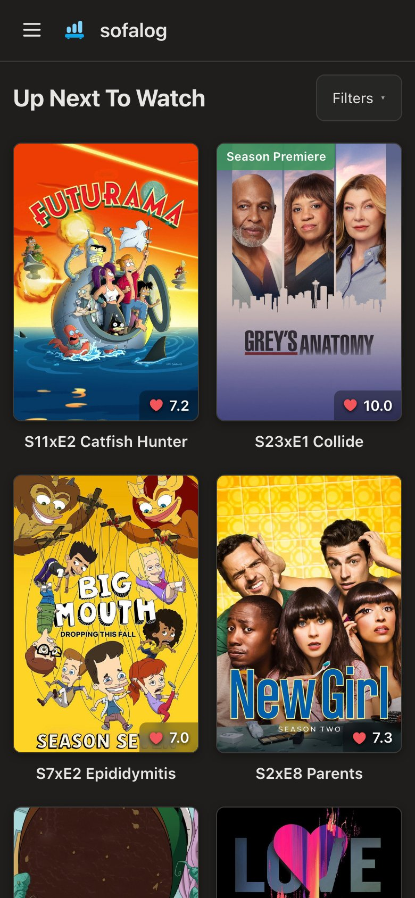

#  sofalog

**A self-hosted, multi-user tracker for the movies, shows and games you watch and play.**

**Website:** <https://mbyte-labs.github.io/sofalog/>

One Go binary with an embedded Svelte web app and a SQLite database, run behind your own reverse
proxy. Metadata comes from [TMDB](https://www.themoviedb.org/) (and Steam for games), but your
library — the text *and* the artwork — is stored on your own server, so it keeps working even when
the provider doesn't. Nothing is shared between accounts unless a user opts in.

> Status: work in progress. Movies and TV are usable today; games (Steam) are the current milestone.
> See [SPEC.md §8](SPEC.md#8-milestones) for the plan.

## What it does

- **Up Next** — every show you have started, with the next unwatched episode one tap away.
- **Upcoming** — a calendar of the episodes and movies you are waiting for, in your time zone.
- **History** — every play is a dated entry; rewatches and backdated watches are first-class, and a
  mis-tap can be removed.
- **Lists** — a watchlist, favorites and dropped shows, each a separate axis from watch status.
- **Ratings** for movies, shows and episodes, with your episode average per season and per show.
- **Where to watch** — streaming availability for your country, plus the physical and digital
  copies you own. A Jellyfin server can fill in the Jellyfin tile automatically.
- **Stats** — hours, plays, streaks, genres, a ratings histogram and your most-watched titles,
  for a year or all time.
- **Trending and Discover** — TMDB's lists, marked against your library.
- **TMDB account sync** — ratings, watchlist and favorites pushed to your own TMDB account.
- **Restore** a Ticket Box export, so an existing Trakt-based history comes along.
- **Multi-user** with email/password or OpenID Connect sign-in; per-user time zones.
- A **PWA**: installs to a phone's home screen and works at every width.

## Screenshots

<p>
  
  
</p>
<p>
  
  
</p>
<p>
  
  
</p>
<p>
  
  
</p>

## Run it with Docker Compose

You need Docker with the Compose plugin and a free TMDB API key
(<https://www.themoviedb.org/settings/api>). Without a key the app runs, but you cannot add
titles.

```bash
git clone https://github.com/mbyte-labs/sofalog.git && cd sofalog
cp env.example .env
```

Open `.env` and set `BASE_URL` to the address people will reach the app at, and **one** of
`TMDB_API_KEY_V3` / `TMDB_API_KEY_V4` (the TMDB page shows both; either works). Then:

```bash
docker compose up -d
```

Browse to `http://localhost:9871`. The first visit is the setup page, which creates the admin
account; everyone else is added under *Settings → Users*. Everything the app stores lands in
`./data` next to the compose file — back that directory up and you have backed up the app.
The container runs as uid/gid `10001`, which must own `./data`; set `SOFALOG_UID` / `SOFALOG_GID` in
`.env` to run it as another user (e.g. `10000` in an LXC container).

Compose pulls the published image `ghcr.io/mbyte-labs/sofalog`; `docker compose up -d --build`
builds it from the checkout instead. Upgrading is `docker compose pull && docker compose up -d`.

### Configuration

The variables most installs set, all in `.env`:

| Variable | What it does |
|---|---|
| `BASE_URL` | **Required.** The absolute URL users open, e.g. `https://media.example.com`. Never derived from request headers. |
| `TMDB_API_KEY_V3` / `TMDB_API_KEY_V4` | TMDB credential — set one. |
| `TMDB_WATCH_REGION` | Country for "where to watch" listings (`RO` by default). |
| `DEFAULT_TIMEZONE` | Zone for users who have not picked one (`UTC` by default). |
| `TRUSTED_PROXIES` | Your reverse proxy's address, so the real client IP is seen. |

Every variable — the refresh intervals, Jellyfin library scan, OpenID Connect sign-on, the two TMDB
credentials and how `.env` is read — is documented in **[docs/configuration.md](docs/configuration.md)**.
[`env.example`](env.example) carries the same list with defaults.

### Reverse proxy

The container speaks plain HTTP and publishes port `9871` on every interface. Put a TLS-terminating
reverse proxy (Caddy, nginx, Traefik) in front of it — HTTPS is what makes the PWA installable —
and set `TRUSTED_PROXIES` to the proxy's address.

## Development

### Repository layout

```
server/     Go module (mbyte.ro/sofalog) — the API and, in production, the embedded SPA
frontend/   Svelte 5 + Vite SPA — built to static files that get embedded into the Go binary
api/        openapi.yaml, the contract for /api/v1
docs/       architecture overview, configuration reference, release notes, screenshots
site/       the GitHub Pages landing page (deployed by .github/workflows/pages.yml)
data/       runtime volume (SQLite DB, artwork, provider cache) — created at runtime, never committed
```

**[SPEC.md](SPEC.md)** is the full specification — stack, architecture, data model, milestones and
scope — and **[docs/architecture.md](docs/architecture.md)** is the visual overview of the runtime
shape and the code structure.

### Prerequisites

- **Go 1.26+** — builds and runs the backend
- **Node.js 22+ with npm** — builds the frontend (not needed in production; the binary embeds the
  built SPA and no Node runtime is deployed)

```bash
git clone https://github.com/mbyte-labs/sofalog.git && cd sofalog
cp env.example .env          # BASE_URL=http://localhost:8080 and a TMDB key
cd frontend && npm install
```

The Go side needs no install step — `go run` / `go build` fetch modules automatically.

### Running for development

Two processes: the Go API and the Vite dev server. The frontend dev server proxies `/api` to the
backend, so you browse the Vite URL and get live reload.

**Terminal 1 — backend on :8080**

```bash
cd server && go run .
```

With a repo-root `.env` in place that is all you need — `BASE_URL` and your TMDB credential come
from `../.env`. Without one, pass the required variable inline:

```bash
cd server && BASE_URL=http://localhost:8080 go run .
```

At startup the server checks the TMDB credential once and logs a `tmdb: ready` line, or a warning
saying what is wrong with it ([docs/configuration.md](docs/configuration.md#the-two-tmdb-credentials)
lists them). Neither stops the server: an unconfigured provider costs you the ability to add new
items, never the library you already have.

**Terminal 2 — frontend on :5173**

```bash
cd frontend && npm run dev
```

Open <http://localhost:5173>. Changes to Svelte code hot-reload; changes to Go code need a restart
of terminal 1.

Quick check that the backend is up:

```bash
curl http://localhost:8080/api/v1/health
```

### Building for production

The production artifact is **one binary**. The frontend is built first so the Go build can embed it:

```bash
cd frontend && npm run build
cd ../server && go build .
```

Then run it (the binary is `server/sofalog`):

```bash
BASE_URL=https://media.example.com DATA_DIR=/var/lib/sofalog ./server/sofalog
```

The Docker image, the GHCR publishing workflow and release tagging are described in
[docs/releasing.md](docs/releasing.md).

### Quality gates

Run before considering any change done:

```bash
cd server && gofmt -l . && go vet ./... && go test ./...
```

```bash
cd frontend && npm run check && npm run lint
```

`npm run format` applies Prettier fixes; `npm run check` is `svelte-check`.

### Conventions

The enforceable rules live in [CLAUDE.md](CLAUDE.md) (layering, data-model invariants, local-first
rules); the reasoning behind them is in [SPEC.md Appendix A](SPEC.md#appendix-a--why-these-decisions).
Highlights:

- Code is organised **per feature** on both sides: `server/features/<component>/<feature>` and
  `frontend/src/features/<component>/<feature>`.
- **No provider call on a render path.** Pages are served from the local snapshot; TMDB and Steam
  are called only in search, tracking, the scheduled refresh and the other call sites SPEC.md lists.
- Every `/api/v1` change lands with the matching [api/openapi.yaml](api/openapi.yaml) update in the
  same commit, and never breaks an existing response shape.
- The SPA build output (`server/web/dist`) is gitignored except a committed stub, and Vite is
  configured to never delete it (`emptyOutDir: false`) — `go build` must work on a fresh clone.
- Adding a Go module or an npm package is a deliberate decision, not a reflex — ask first.
- Never write into `data/` from tooling; it is a runtime volume.

## License

sofalog is free software under the [GNU Affero General Public License v3.0 or later](LICENSE).
