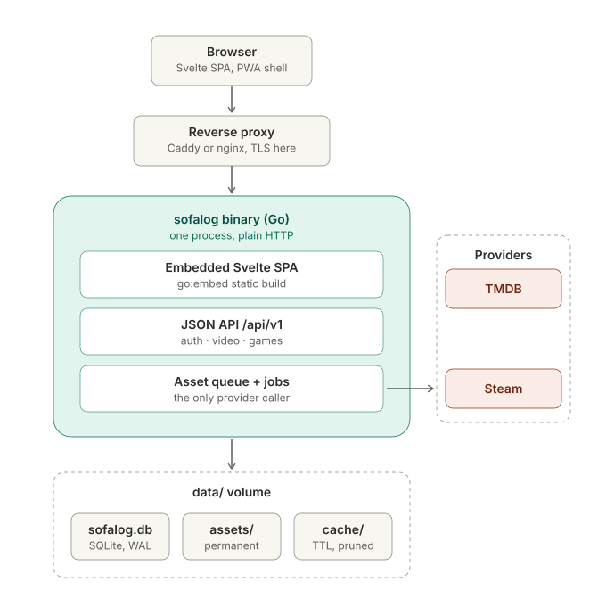
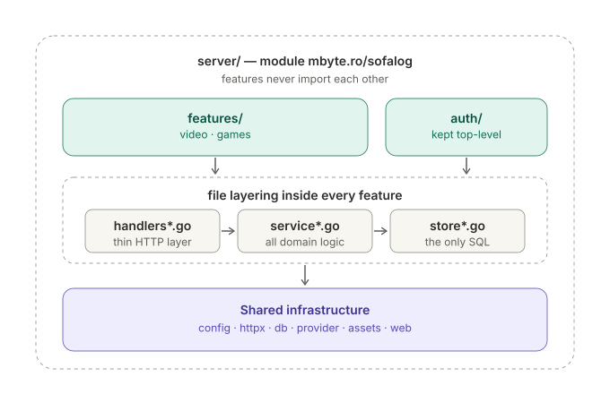

# Architecture overview

A visual companion to [`SPEC.md`](../SPEC.md), which remains the single source of truth. If a
diagram here disagrees with the spec, the spec wins and the diagram needs updating. Decision ids
(`D-00x`) refer to [SPEC.md Appendix A](../SPEC.md#appendix-a--why-these-decisions).

## Runtime shape

One Go binary serves everything: the embedded Svelte SPA, the `/api/v1` JSON API, and the
background asset queue. A reverse proxy in front owns TLS and the public hostname; the binary
speaks plain HTTP only and honours `X-Forwarded-*` headers solely from configured trusted proxies,
with `BASE_URL` as the single source of truth for external URLs.

What the picture encodes:

- **The asset queue is the only provider caller.** No page render or API read ever touches TMDB or
  Steam (D-004, D-006). Search results land in `data/cache/`; adding an item
  *promotes* the cached files into `data/assets/` (keyed by internal database id) and stores a full
  metadata snapshot in SQLite. The app stays fully usable when providers are down or gone.
- **`data/` is the entire state of the system** — the SQLite database, permanent artwork in
  `assets/`, and a TTL-bound `cache/`. Back up that directory and you have backed up everything.
  Untracking never hard-deletes from it without confirmation and a deferred sweep (D-008).
- **Deploying is copying one file.** The SPA build is compiled into the binary via `go:embed`;
  migrations apply automatically at startup.

## Code structure

Code is organised per feature, not per technical layer (D-014). The media features live under
`server/features/` (imports read `mbyte.ro/sofalog/features/video`); `auth` is also a feature but
stays top-level because it is cross-cutting. Each feature is one Go package; the
`handlers → service → store` layering survives as a strict file-naming convention checked by
`/verify` greps, not compiler-enforced package boundaries.

- A request flows: the handler decodes and validates, calls exactly **one** service function, and
  encodes the result. All domain logic lives in `service*.go`; all SQL lives in `store*.go`, where
  every personal-state query filters on the authenticated user's id.
- Features depend on shared infrastructure (`config`, `httpx`, `db`, `provider`, `assets`, `web`),
  never on each other.
- The frontend mirrors the layout: `frontend/src/features/<feature>/` holds each feature's routes,
  components and stores, with only the fetch client and image helper shared in `src/lib/`. The
  bundled SPA is the reference client of `/api/v1` — screens never get data the public API cannot
  express.

## Updating the diagrams

The diagrams are plain hand-editable SVGs in [`diagrams/`](diagrams/). Keep them in sync with
`SPEC.md` §3 when the architecture changes.
